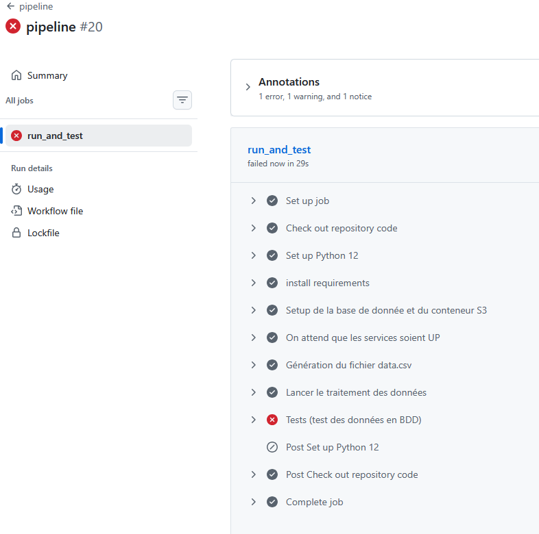
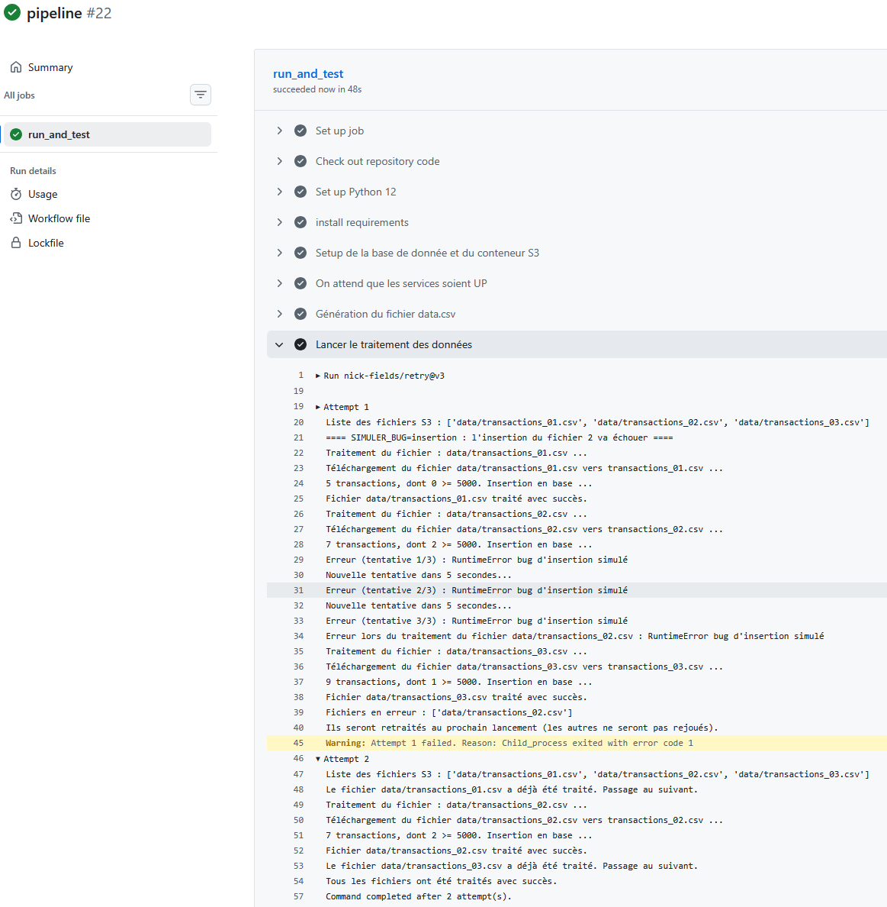
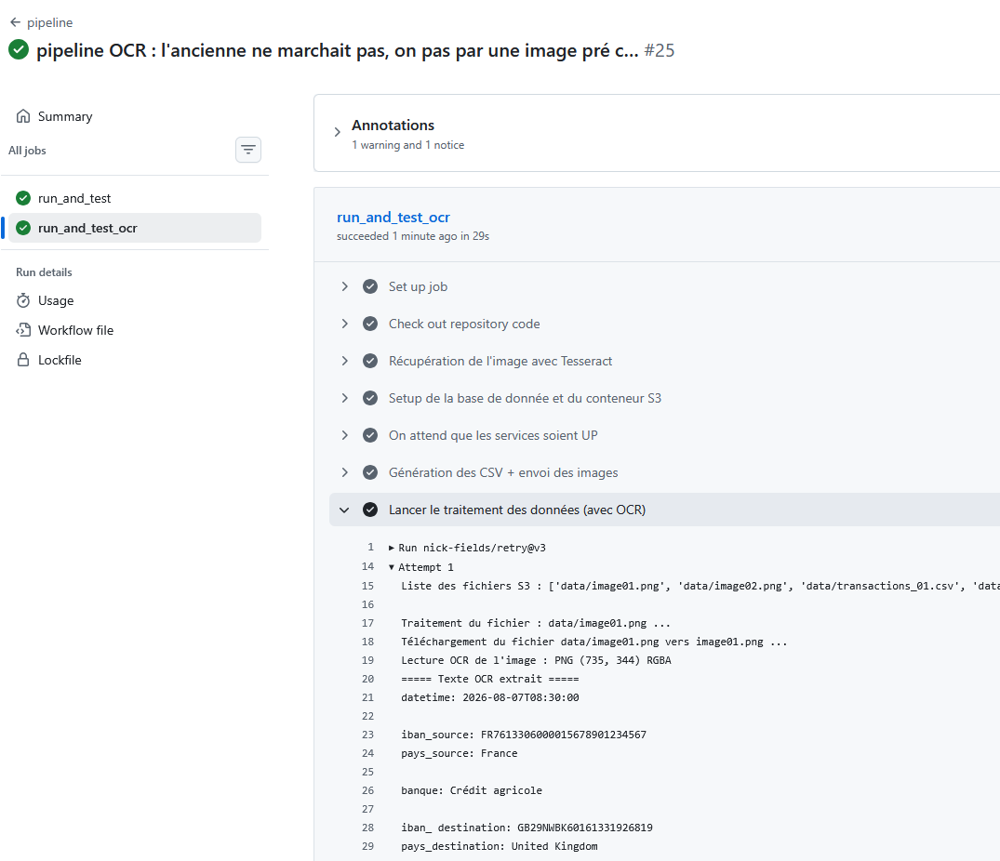

# Mini projet Data Engineering - CI/CD

Dans le cadre du cours EFREI M2 CI/CD : Mini projet Data Engineering

[](https://github.com/anthonybnl/cicd_mini_projet_de/actions/workflows/pipeline.yml)

## Génération des données

Le script `src/generation_data.py` génère 3 fichiers CSV de 5 à 10 transactions chacun, puis les envoie dans le bucket S3.

Les données générées aléatoirement mais avec une **seed fixe** (`SEED = 2026`) : elles sont donc identiques à chaque exécution ce qui rend le pipeline testable (`pytest`)

## Simulation d'un bug dans la génération des données

Afin de pouvoir vérifier le bon fonctionnement des tests, nous pouvons simuler un bug via la variable d'environnement `SIMULER_BUG=generation`  
Lorsque cette variable est définie avec cette valeur, des changements interviennent dans les données générées.

Ainsi les tests ne passent plus.

Sur un `push` classique, la variable est vide et aucun bug n'est simulé.

Afin de déclencher ce comportement il faut lancer la pipeline manuellement et choisir l'option `generation` pour le choix `Bug à simuler`

Résultat :

[Lien vers la pipeline](https://github.com/anthonybnl/cicd_mini_projet_de/actions/runs/42994084459)



## Ajout du retry sur le traitement des données

### Mémoire des fichiers traités

La liste des fichiers déjà traités est stockée en base, dans la table `fichiers_traites` (voir `ddl/02-fichiers-traites.sql`).

Pour chaque fichier, l'insertion des résultats **et** l'inscription du fichier dans `fichiers_traites` se font dans **une seule transaction**.  
S'il n'y a pas d'erreur, le fichier est traité et marqué comme traité. Sinon tout est annulé : **rollback**.

Les montants s'additionnent à ceux déjà en base, c'est l'agrégation incrémentale.

### Deux niveaux de retry

1. **Dans le script** : le téléchargement depuis le S3 et l'insertion en base sont retentés 3 fois (5 secondes d'attente), pour les erreurs passagères (S3 ou BDD indisponible un court instant)
2. **Dans la pipeline** : si un fichier est toujours en erreur, le script se termine avec un code d'erreur et la pipeline le relance. Grâce à la table `fichiers_traites`, seuls les fichiers en erreur sont rejoués.

### Simulation d'un bug d'insertion

Pour tester ce mécanisme, nous pouvons simuler un bug d'insertion via la variable d'environnement `SIMULER_BUG=insertion`.  
L'insertion du fichier 2 échoue alors au milieu de la transaction (après l'insertion des montants, avant le marquage du fichier) : tout est annulé par le rollback.

Le bug n'est simulé qu'au **premier lancement** du script : un fichier `bug_insertion` est créé à la racine du projet. Au lancement suivant, le fichier existe déjà et le bug n'est plus simulé. Le fichier est supprimé quand tous les fichiers sont traités avec succès.

Déroulement attendu :

1. **Premier lancement** : le fichier 1 est traité, le fichier 2 échoue 3 fois (retry dans le script), le fichier 3 est traité. Le script se termine en erreur.
2. **Retry de la pipeline** : les fichiers 1 et 3 sont ignorés (déjà traités), le fichier 2 est traité avec succès.
3. **Tests** : ils passent, aucun montant n'a été compté deux fois.

Afin de déclencher ce comportement il faut lancer la pipeline manuellement et choisir l'option `insertion` pour le choix `Bug à simuler`

Résultat :

[Lien vers la pipeline](https://github.com/anthonybnl/cicd_mini_projet_de/actions/runs/42999708761)



## Bonus OCR : transactions contenues dans des images

En plus des CSV, la pipeline peut lire des transactions dans des images grâce à un OCR (Tesseract, via `pytesseract`).

### Fonctionnement

Les images sont dans le dossier `images/` (une transaction par image, une ligne `clé: valeur` par colonne).  
Elles sont faites à la main et versionnées, afin de pouvoir tester la pipeline (reproductibilité)

Quand la variable d'environnement `WITH_OCR=1` est définie :

1. `generation_data.py` envoie toutes les images `.png` du dossier dans le bucket S3, à côté des CSV
2. `traiter_data.py` lit les images avec l'OCR, puis le texte obtenu est transformé en transactions, avec les mêmes colonnes que le CSV. Le reste du traitement est identique.

Si l'OCR lit mal une valeur (IBAN tronqué, montant ou date illisible), le fichier part en erreur sans bloquer les autres, comme pour un CSV.

### Dans la CI

Le workflow contient deux jobs séparés, lancés en parallèle :

- `run_and_test` : la pipeline sans OCR (CSV uniquement)
- `run_and_test_ocr` : la pipeline avec OCR (CSV + images)

L'installation de Tesseract dans le pipeline était complexe et le job échouait.  
Une solution a été trouvée : apsser par une **image docker pré construite** (`Dockerfile.cicd`), publiée sur le repo GitHub (`ghcr.io/anthonybnl/cicd_mini_projet_de-ocr`).  
Elle contient Python, Tesseract (avec le modèle français `tesseract-ocr-fra`, pour les accents) et les dépendances Python.

Le job OCR fait simplement des `docker run` de cette image pour lancer les deux scripts python et les tests.
Le code n'est **pas inclu** dans l'image : il est monté depuis le checkout (`-v`), donc c'est toujours le code du commit qui est testé.  
L'image n'est à reconstruire que si le `Dockerfile.cicd` ou le `requirements.txt` change.

### Résultat

[Lien vers le pipeline](https://github.com/anthonybnl/cicd_mini_projet_de/actions/runs/43047949855/job/130616872203)



### Construire et publier l'image de la CI

```bash
docker login ghcr.io -u <username>
docker build -f Dockerfile.cicd -t ghcr.io/<username>/<image>:<tag> .
docker push ghcr.io/<username>/<image>:<tag>
```
