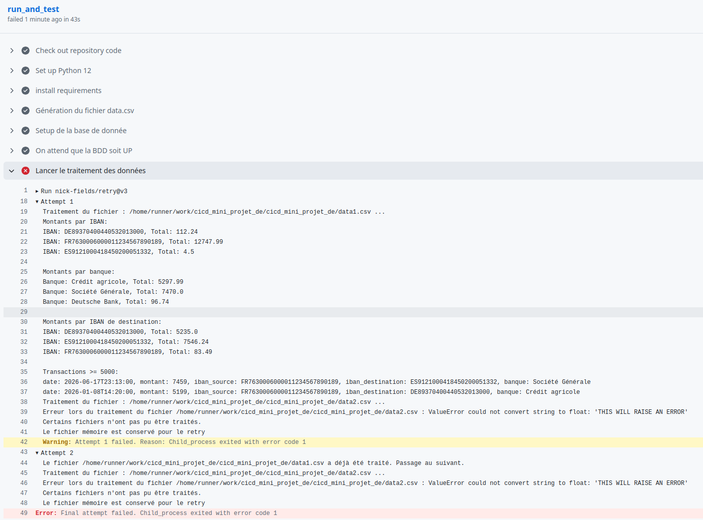

# Mini projet Data Engineering - CI/CD

Dans le cadre du cours EFREI M2 CI/CD : Mini projet Data Engineering

[](https://github.com/anthonybnl/cicd_mini_projet_de/actions/workflows/pipeline.yml)

## Simulation d'une erreur de calcul

[Lien vers la pipeline](https://github.com/anthonybnl/cicd_mini_projet_de/actions/runs/39763114617)

Afin de tester la robustesse de notre pipeline CI/CD, notamment des tests, nous avons volontairement changer une règle de calcul (moyenne au lieu de somme)

Résultat :


Comme on peut le voir, les tests ont échoué car la règle de calcul a été modifiée.

## Ajout du retry sur le traitement des données

[Lien vers la pipeline](https://github.com/anthonybnl/cicd_mini_projet_de/actions/runs/39779392118)


Pour avoir une gestion du retry, nous avons commencé par changer notre génération de données : celle ci génère désormais 2 fichiers CSV, dont un comportant une erreur (chaîne de caractères au lieu d'un montant)

Ensuite nous avons modifié le script de traitement : celui ci liste les fichiers *.csv à traiter.  
Pour chaque fichier, il le traite, et si le traitement réussit, ce fichier est inscrit dans une mémoire (fichier JSON en local)  
Si un des fichiers échoue, celui ci n'est pas inscrit dans la mémoire.
Si tous les fichiers sont traités avec succès, le fichier mémoire est supprimé.

Ainsi, lors du retry dans le pipeline, le script de traitement ne va relancer que les fichiers qui n'ont pas été traités avec succès lors des tentatives précédentes.

dans le pipeline CI/CD :

```yml
- name: Lancer le traitement des données
uses: nick-fields/retry@v3
with:
    timeout_seconds: 5
    max_attempts: 2
    command: python src/traiter_data.py
```

Résultat :



Nous constatons bien que le retry fonctionne correctement : la tâche se lance une deuxième fois et seuls les fichiers non traités avec succès lors des tentatives précédentes sont relancés.
