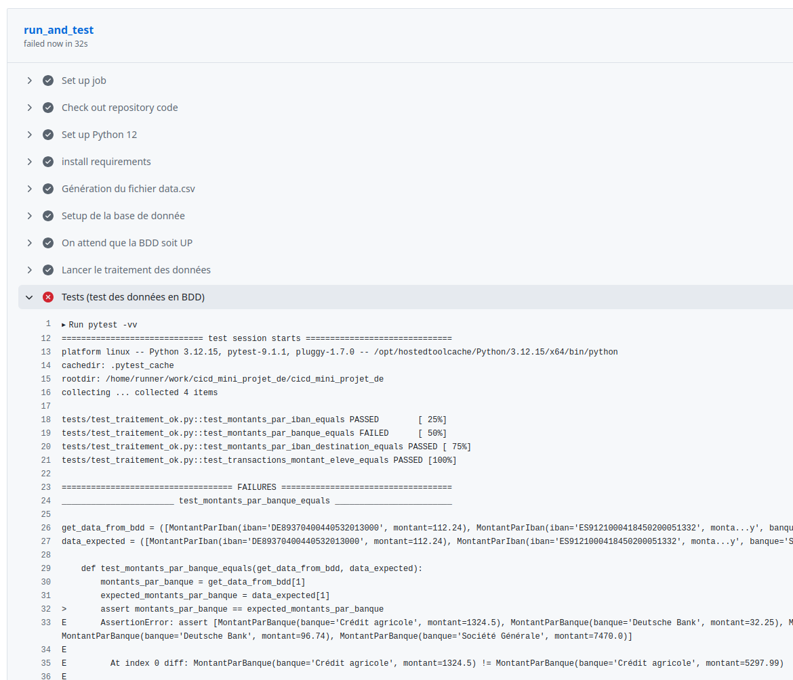

# Mini projet Data Engineering - CI/CD

Dans le cadre du cours EFREI M2 CI/CD : Mini projet Data Engineering

## Simulation d'une erreur de calcul

Afin de tester la robustesse de notre pipeline CI/CD, notamment des tests, nous avons volontairement changer une règle de calcul (moyenne au lieu de somme)

Résultat :

Comme on peut le voir, les tests ont échoué car la règle de calcul a été modifiée.
