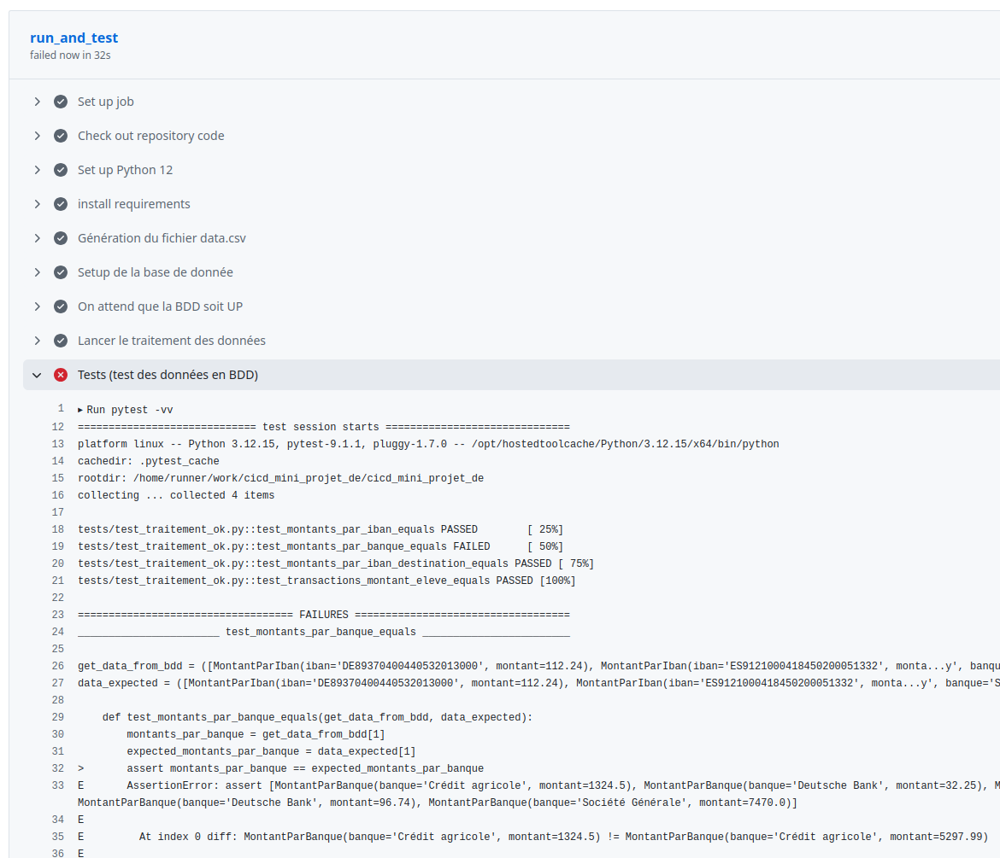

# Mini projet Data Engineering - CI/CD

Dans le cadre du cours EFREI M2 CI/CD : Mini projet Data Engineering

[](https://github.com/anthonybnl/cicd_mini_projet_de/actions/workflows/pipeline.yml)

## Génération des données

Le script `src/generation_data.py` génère 3 fichiers CSV de 5 à 10 transactions chacun, puis les envoie dans le bucket S3.

Les données générées aléatoirement mais avec une **seed fixe** (`SEED = 2026`) : elles sont donc identiques à chaque exécution ce qui rend le pipeline testable (`pytest`)

## Simulation d'une erreur de calcul

[Lien vers la pipeline](https://github.com/anthonybnl/cicd_mini_projet_de/actions/runs/39763114617)

Afin de tester la robustesse de notre pipeline CI/CD, notamment des tests, nous avons volontairement changer une règle de calcul (moyenne au lieu de somme)

Résultat :



Comme on peut le voir, les tests ont échoué car la règle de calcul a été modifiée.

## Ajout du retry sur le traitement des données

[Lien vers la pipeline](https://github.com/anthonybnl/cicd_mini_projet_de/actions/runs/39779392118)

Le script de traitement liste les fichiers CSV présents dans le bucket et les traite **un par un**.

### Mémoire des fichiers traités

La liste des fichiers déjà traités est stockée en base, dans la table `fichiers_traites` (voir `ddl/02-fichiers-traites.sql`).

Pour chaque fichier, l'insertion des résultats **et** l'inscription du fichier dans `fichiers_traites` se font dans **une seule transaction**.  
S'il n'y a pas d'erreur, le fichier est traité et marqué comme traité. Sinon tout est annulé : **rollback**.

Les montants s'additionnent à ceux déjà en base, c'est l'agrégation incrémentale.

### Deux niveaux de retry

1. **Dans le script** : le téléchargement depuis le S3 et l'insertion en base sont retentés 3 fois (5 secondes d'attente), pour les erreurs passagères (S3 ou BDD indisponible un court instant)
2. **Dans la pipeline** : si un fichier est toujours en erreur, le script se termine avec un code d'erreur et la pipeline le relance. Grâce à la table `fichiers_traites`, seuls les fichiers en erreur sont rejoués.

## Installation de Tesseract (OCR)

Afin de faire fonctionner `pytesseract` pour l'OCR, il est nécessaire d'installer Tesseract :

```bash
sudo apt install tesseract-ocr
sudo apt install libtesseract-dev
```
